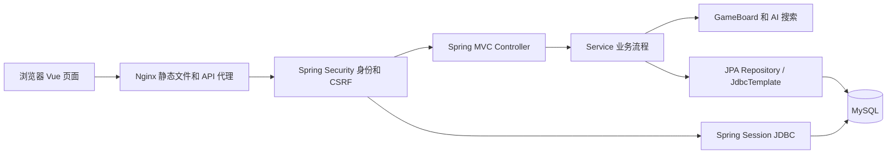
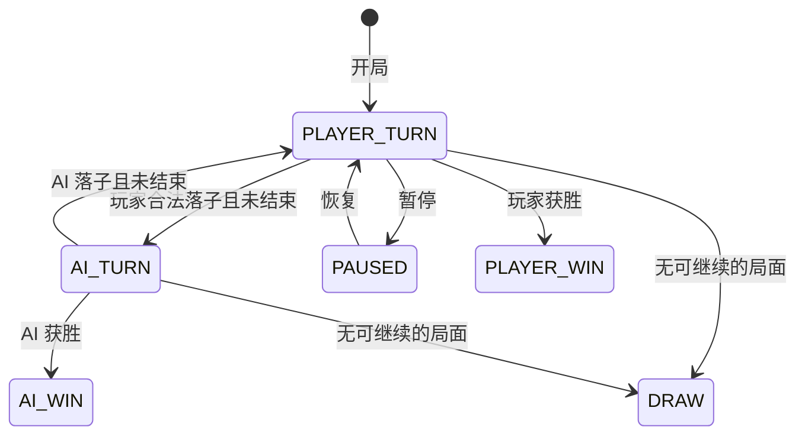

# 五子棋项目：从零理解、逐层拆解与简历面试学习手册

> 适用对象：准备把项目写进简历，但对 Vue、Spring Boot、数据库、安全、并发和部署还不熟悉的同学。  
> 核对日期：2026-10-07。依据是当前工作区源码，包含尚未提交的改动，不代表某个已发布版本。  
> 本次工作是源码分析与文档整理，未重新运行应用、测试或部署；“存在实现/测试”与“已完成实机验收”会明确区分。

本文以 Java 后端/全栈校招面试为主线。每项技术尽量回答四件事：**是什么、解决什么问题、项目哪里用了、面试如何解释**。先理解调用链，再背术语；否则面试官问到“具体在哪个方法实现”，很容易答不上来。

## 阅读导航

| 学习阶段 | 对应章节 | 学完应该能做到 |
| --- | --- | --- |
| 建立整体认识 | 第 1～3 章 | 说清项目功能、技术栈、目录职责 |
| 理解运行原理 | 第 4～9 章 | 从浏览器点击追踪到数据库，再回到页面 |
| 理解工程难点 | 第 10～13 章 | 讲清并发、幂等、恢复、AI 限时、部署和测试 |
| 自己动手重建 | 第 14 章 | 按顺序做出最小版本，再逐步完善 |
| 面试复习 | 第 15～17 章 | 用项目实例回答八股，写出可信简历 |
| 查代码和补基础 | 第 18～19 章 | 按索引定位源码、查阅官方解释 |

---

## 1. 先说清楚：这到底是一个什么项目

### 1.1 一句话介绍

这是一个**前后端分离的五子棋人机对战 Web 应用**。浏览器负责页面和棋盘交互，Java 服务负责登录认证、规则校验、AI 落子和积分，MySQL 保存用户、积分、登录会话和棋局，Docker Compose 负责组合启动。

“前后端分离”表示前端页面与后端业务代码分开开发，通过 HTTP 接口交换 JSON 数据；不意味着必须部署在不同域名。

### 1.2 已有功能与真实范围

| 功能 | 当前源码实现 | 需要理解的边界 |
| --- | --- | --- |
| 注册、登录、注销 | Spring Security + BCrypt + Session | 没有使用 JWT 登录 |
| 经典对弈 `TWO` | 15×15，玩家黑子对战白子 AI | 名字中的“双人”指两种棋子，不是两个在线用户 |
| 三人对弈 `THREE` | 25×25，玩家黑子 + 白子 AI + 灰子 AI | 实际仍只有一个真人 |
| 障碍物 `OBSTACLE` | 15×15，假山、水潭、地形变化 | 是自定义玩法 |
| 三人障碍物 `THREE_OBSTACLE` | 25×25，三种棋子加地形 | 灰子 AI 难度会降低一级，最低保持 EASY |
| 动态棋盘 `DYNAMIC` | 15×15，划分为 5×5 个区块，每区块 3×3 | 中心区块初始开放，支持令牌解锁和封印 |
| 难度 | EASY、MEDIUM、HARD | 是传统搜索算法，不是训练出的模型 |
| 悔棋、暂停、恢复 | 服务端控制状态，悔棋恢复整回合快照 | 已结束对局不能任意恢复到进行中 |
| 个人积分 | 胜 +3、负 -1、平 +1，统计胜率 | 没有排行榜接口；总积分允许为负 |
| 重启后恢复 | JDBC Session + `active_game` 持久化 | 依赖数据库仍可用、会话未过期、数据卷保留 |
| 容器部署 | 前端、后端、MySQL 三个服务 | 默认只绑定本机回环地址，不是已经公开上线 |
| 在线真人对战 | 仅有需求草案 | 不属于当前已实现功能 |

**特别注意：**源码中有个别旧注释，例如三人模式棋盘大小的注释与实际代码不同。本文以执行逻辑为准：三人相关模式是 25×25，其余是 15×15。

### 1.3 不要写进“已使用技术栈”的内容

当前业务没有使用 Redis、MyBatis、JWT、WebSocket、消息队列、微服务、Kubernetes、Pinia、TypeScript、Element Plus，也没有接入大语言模型。

根目录 `package.json` 中的 `docx`、`pptxgenjs`、`sharp`、`adm-zip` 属于报告/文档素材处理依赖，不能当作五子棋运行时核心技术。仓库里的 `skill/` 是辅助资料，不是游戏服务框架。

## 2. 技术栈总表：每个名字到底负责什么

版本说明：前端 `package.json` 的 `^` 表示版本范围，不是精确安装版本；精确版本由 `gobang-frontend/package-lock.json` 锁定。下面先列项目声明。Spring Boot 版本来自 POM，容器镜像版本来自 Compose/Dockerfile，不推断本机实际运行版本。

### 2.1 前端技术

| 技术 | 通俗解释 | 本项目用在哪里 | 学习优先级 |
| --- | --- | --- | --- |
| HTML | 定义页面元素与结构 | 页面模板、按钮、表单、Canvas | 必学 |
| CSS | 控制颜色、布局、大小、动画 | 各 Vue 页面的样式 | 必学基础 |
| JavaScript | 让网页能执行交互逻辑 | 点击事件、接口请求、状态更新 | 必学 |
| Vue 3，声明 `^3.5.0` | 用数据驱动页面的框架 | 四个 View，`ref`、`computed`、生命周期 | 必学 |
| Composition API / `<script setup>` | 把页面状态与操作写在一起的组织方式 | 各 `.vue` 文件脚本区 | 必学 |
| Vue Router 4，声明 `^4.4.0` | 浏览器内的页面导航 | `/login`、`/lobby`、`/game`、`/profile` | 必学 |
| Axios，声明 `^1.7.0` | 发 HTTP 请求的库 | `src/api/index.js`，统一前缀、超时、错误、CSRF | 必学 |
| Canvas 2D | 在一块画布上直接绘图 | `GameView.vue` 绘棋盘、棋子和地形 | 理解实现 |
| Vite 6，声明 `^6.0.0` | 开发服务器和打包工具 | 开发代理；`npm run build` 生成静态产物 | 理解流程 |
| `@vitejs/plugin-vue`，声明 `^5.2.0` | 让 Vite 能处理 Vue 单文件组件 | `vite.config.js` 的 `plugins: [vue()]` | 知道用途 |
| sessionStorage | 浏览器当前标签页的临时存储 | 保存用户显示信息、模式和页面切换时的状态 | 必学边界 |
| HTML Audio / Web Audio | 浏览器音频能力 | 背景音乐和落子音效 | 知道用途 |
| Node.js / npm | 运行前端工具、管理包 | 构建镜像采用 Node 22；npm 安装依赖 | 理解用途 |

Node.js 在这里主要用于构建工具，不承担游戏业务后端。浏览器运行的是构建后的 JavaScript，不会在浏览器里运行 Node 服务。

### 2.2 后端、数据和测试技术

| 技术 | 通俗解释 | 本项目用在哪里 | 学习优先级 |
| --- | --- | --- | --- |
| Java 21 | 后端编程语言与运行环境 | 控制器、服务、算法、数据模型 | 必学 |
| Maven / Maven Wrapper | 管理 Java 依赖、编译、测试、打包 | `pom.xml`、`mvnw.cmd` | 必学流程 |
| Spring Boot 3.5.15 | 帮你组装和启动 Spring 应用 | 启动类、starter、配置文件 | 必学 |
| Spring IoC / DI | 由容器创建对象并传入依赖 | `@Service`、`@Component`、构造器注入 | 必学 |
| Spring MVC | 把 HTTP 请求映射到 Java 方法 | `UserController`、`GameController`、`ScoreController` | 必学 |
| 内嵌 Servlet 容器 | 接收 HTTP 请求并交给应用 | Web starter 默认提供的 Tomcat | 理解用途 |
| Spring Security | 统一身份认证、授权和请求安全 | `SecurityConfig`、认证上下文、CSRF | 必学 |
| BCrypt | 带盐、带计算成本的密码哈希 | 注册时编码，登录时匹配 | 必学 |
| Spring Session JDBC | 把 HTTP Session 存进数据库 | `spring.session` 配置、V4 迁移 | 必学恢复机制 |
| Bean Validation | 根据注解验证请求参数 | `@Valid`、`@NotBlank`、`@Min`、`@Pattern` | 必学 |
| Spring Data JPA | 用 Repository 接口访问数据 | 用户、积分、结果仓储 | 必学 |
| Hibernate | 执行 JPA 对象关系映射 | `@Entity` 映射与结构校验 | 理解与 JPA 的关系 |
| JDBC / JdbcTemplate | 通过 SQL 直接操作数据库 | `GameStateStore` 加锁读取和保存棋局 | 必学 |
| MySQL Connector/J | Java 连接 MySQL 的驱动 | 数据源的底层通信 | 知道用途 |
| MySQL / InnoDB | 持久化数据并提供事务与锁 | Compose 指定 MySQL 8.4.11 | 必学 |
| Flyway | 按版本执行数据库结构变更 | V1～V5 SQL 迁移 | 必学 |
| Spring 事务 / `@Transactional` | 把多次数据库操作作为一个整体提交 | 注册、落子、结算 | 必学 |
| Jackson | Java 对象与 JSON 的相互转换 | HTTP JSON、`state_json` 序列化 | 理解用途 |
| Java 并发工具 | 多请求并发时控制共享状态与计算资源 | 分段锁、并发 Map、线程池、Future | 面试重点 |
| Actuator / Micrometer | 提供健康信息、记录指标 | 健康检查、AI 耗时与降级次数 | 理解用途 |
| SLF4J 日志接口 | 用统一方式输出日志 | AI 超时、全局异常日志 | 知道用途 |
| JUnit 5 / AssertJ / Mockito | 测试执行、断言、替代依赖 | `src/test` 下的规则、服务与安全测试 | 必学基础 |
| Spring Boot Test / MockMvc | 测 Spring 上下文或 HTTP 层 | 结算集成测试、安全测试 | 理解测试分层 |
| H2 | 测试用内存数据库 | MySQL 兼容模式的迁移、存储、结算测试 | 理解边界 |

### 2.3 部署技术

| 技术 | 解决的问题 | 本项目位置 |
| --- | --- | --- |
| Docker | 将运行环境与程序一起封装 | 前后端 Dockerfile |
| Docker Compose | 用一个配置启动多个容器及网络、卷 | `compose.yaml` |
| Nginx | 提供前端静态文件，并转发 `/api` | `gobang-frontend/nginx.conf` |
| 多阶段构建 | 最终镜像只保留运行所需产物 | Node → Nginx；JDK → JRE |
| 环境变量 | 将环境配置与源码分开 | `.env.example`、`${DB_PASSWORD}` 等 |
| 健康检查 | 判断数据库或应用是否能响应 | MySQL ping、`/actuator/health`、`/healthz` |
| 命名数据卷 | 容器替换后继续保留数据库文件 | `gobang_mysql_data` |
| WSL 2 | Windows 上运行 Linux 容器的环境支持 | Docker Desktop 使用场景及辅助脚本 |

## 3. 项目结构与分层：先认识各个“部门”

### 3.1 目录地图

```text
Gobang 项目版/
├── gobang-frontend/
│   ├── src/main.js                 前端入口，获取 CSRF，校验登录提示
│   ├── src/App.vue                 路由页面的容器
│   ├── src/router/index.js         页面路由与前端导航守卫
│   ├── src/api/index.js            HTTP 请求封装
│   ├── src/views/                  登录、大厅、对局、个人积分页
│   ├── public/                     背景图、音乐等静态资源
│   ├── vite.config.js              开发代理
│   ├── nginx.conf                  部署时静态资源与接口代理
│   └── Dockerfile                  前端镜像构建
├── gobang-backend/
│   ├── pom.xml                     后端依赖与构建规则
│   ├── src/main/java/com/gobang/
│   │   ├── GobangApplication.java  后端入口
│   │   ├── controller/             HTTP 接口层
│   │   ├── service/                业务流程、AI 调度、棋局存储
│   │   ├── repository/             JPA 数据访问接口
│   │   ├── entity/                 数据库实体
│   │   ├── dto/                    请求与响应的数据结构
│   │   ├── ai/                     棋盘规则与搜索算法
│   │   ├── config/                 安全与跨域配置
│   │   ├── security/               登录身份、限流器
│   │   └── common/                 全局异常处理
│   ├── src/main/resources/
│   │   ├── application.yml         默认配置
│   │   ├── application-prod.yml    prod 环境覆盖配置
│   │   └── db/migration/           Flyway 数据库版本文件
│   ├── src/test/                   自动化测试
│   └── Dockerfile                  后端镜像构建
├── compose.yaml                   三个服务的组合部署
├── start.bat / start-docker.bat    本机/容器启动入口
├── sql/init.sql                   数据库初始化辅助脚本
└── docs/                          需求和学习文档
```

### 3.2 为什么要分 Controller、Service、Repository

可以类比餐厅：Controller 是接单窗口，Service 是按业务规则组织制作的后厨，Repository 是访问库存的工作人员，数据库是仓库。

| 层 | 应该做的事 | 项目例子 |
| --- | --- | --- |
| Controller | 接收参数、获得当前身份、调用业务、返回响应 | `GameController.move()` |
| Service | 决定当前是否能下、怎么下、何时结算 | `GameService.playerMove()` |
| 规则/算法 | 计算五连、禁手、候选点、AI 最优选择 | `GameBoard`、`GobangAI` |
| Repository / Store | 读取与写入数据、执行锁查询 | `ScoreRepository`、`GameStateStore` |
| Entity | 表对应的 Java 数据模型 | `UserInfo`、`Score`、`GameResult` |
| DTO | 前后端交互的数据合同 | `MoveRequest`、`GameStateDTO`、`UserResponse` |

这样做的价值是：修改 HTTP 路径不必改算法；测试棋盘规则不必启动网页；数据库实体中有密码字段，但公开响应 DTO 可以不包含密码。

当前并不是所有模块都严格经过 JPA Repository：棋局存储直接使用 JdbcTemplate。这是为了直观表达 SQL 与行锁，也是项目真实的混合数据访问方式。

### 3.3 整体架构



如果阅读器不能显示 Mermaid，可以把它理解为：**浏览器 → Nginx → 安全检查 → 接口 → 业务 → 算法/数据库 → JSON 响应 → 更新页面**。

## 4. 第 1 层：前端如何从代码变成能操作的页面

### 4.1 Vue 单文件组件是什么

一个 `.vue` 文件常有三部分：`<template>` 定义页面，`<script setup>` 定义数据与行为，`<style>` 定义外观。项目将登录、大厅、对局、积分分别写成独立页面。

理解以下教学示例即可读懂大量页面代码；这不是新增到项目的功能：

```vue
<script setup>
import { ref, computed } from 'vue'
const wins = ref(0)
const label = computed(() => `胜利 ${wins.value} 次`)
function addWin() { wins.value++ }
</script>

<template>
  <button @click="addWin">{{ label }}</button>
</template>
```

`ref` 创建可被 Vue 追踪的数据；脚本里通过 `.value` 访问。模板中通常自动解包。数据变化后，相关 DOM 更新由 Vue 调度。项目中的 `status`、`board`、`difficulty` 都采用这种模式。[Vue 响应式基础](https://vuejs.org/guide/essentials/reactivity-fundamentals.html)

### 4.2 本项目用到的 Vue 能力

| 写法 | 你应该怎样理解 | 项目实例 |
| --- | --- | --- |
| `ref()` | 保存会改变的数据 | 棋盘、回合、错误消息 |
| `computed()` | 根据已有数据计算结果 | 三人模式选 25×25 棋盘；计算胜率展示 |
| `watch()` | 数据变化后执行副作用 | 状态改变后调整思考提示和计时器 |
| `onMounted()` | 页面挂载后执行初始化 | 获取服务端棋局、绘制画布、初始化音乐 |
| `onUnmounted()` | 页面离开时清理资源 | 清理计时器、音频，保存临时页面状态 |
| `nextTick()` | 等本轮 Vue DOM 更新完成 | 恢复模式后，等待画布尺寸更新再绘图 |
| `v-if` | 条件成立才显示对应结构 | 暂停/恢复按钮、胜负弹窗 |
| `v-for` + `key` | 根据列表生成元素并标识身份 | 规则条目、聊天短语 |
| `v-model` | 表单输入与变量同步 | 登录昵称、密码等输入 |
| `@click` | 绑定点击事件 | 开始游戏、落子、悔棋 |

`computed` 适合“计算一个值”；`watch` 适合“值改变后做一件事”。不要把发送请求、启动计时器这类副作用塞进计算属性。

### 4.3 路由与登录提示

`createWebHistory()` 使用正常路径，例如 `/game`。路由组件采用 `() => import(...)`，访问时加载对应页面代码。

`beforeEach` 检查 `sessionStorage` 里的 `user`，决定是否跳转登录页。这只改善导航体验，用户可以自行修改浏览器存储，所以**真正的登录检查必须由后端完成**。

`main.js` 启动时先请求 CSRF 令牌。如果本地存在用户提示，再调用 `/api/user/info` 对照服务端身份。当前逻辑并不会在所有新标签页里无条件发现有效 Session；“数据库有 Session”与“所有前端入口都会自动恢复导航”是两回事。

### 4.4 Axios 如何统一请求

`src/api/index.js` 创建统一实例：

```javascript
const api = axios.create({
  baseURL: '/api',
  timeout: 10000,
  withCredentials: true,
  withXSRFToken: true,
  xsrfCookieName: 'XSRF-TOKEN',
  xsrfHeaderName: 'X-XSRF-TOKEN'
})
```

所有页面只调用 `gameApi.move(row, col)` 等方法，不必反复填写域名、超时和令牌参数。响应拦截器统一处理业务数据和未登录跳转。

**本项目的特殊约定：**一些 HTTP 错误会被拦截器转换成正常返回的 `{ code, message, data }` 对象。因此 `await` 返回不代表业务成功，页面仍要检查 `res.code`，不能只靠 `catch`。

### 4.5 Canvas 为什么要单独绘制

Vue 管页面 DOM；Canvas 是像素画布。修改 `board.value` 后，需要代码调用 `drawBoard()` 才会把新棋局画上去，不能认为 Vue 会自动理解每一颗棋子。

落子坐标转换在 `getBoardPos()`：

```text
浏览器点击坐标
→ 减去 Canvas 在页面中的左上角位置
→ 按“内部画布尺寸 / CSS 显示尺寸”换算
→ 减去棋盘边距 PADDING
→ 除以格子间距并取最近整数
→ 获得 row、col
```

核心表达式是 `col = round((x - PADDING) / cellSize)`，行坐标同理。缩放换算避免手机或缩小窗口时出现“点击这里，棋子落到旁边”。

### 4.6 页面状态不是最终裁判

前端会拦截明显无效的点击，例如非玩家回合、已有棋子、假山。但后端仍要重复检查，因为用户可以绕过页面直接发 HTTP 请求。

前端保存 `gameState` 只是为了页面切换体验。进入对局页后，`restoreFromServer()` 会重新获取服务端状态并覆盖本地显示；如果恢复在 AI 回合，还会继续请求 AI 落子。

## 5. 第 2 层：HTTP 接口与后端入口

### 5.1 HTTP、JSON、API 各是什么

- HTTP：浏览器向服务端提出请求、服务端返回结果的通信协议。
- API：约定好的访问入口，例如“POST `/api/game/move` 表示落子”。
- JSON：请求和响应所使用的文本数据格式，适合表示对象、数组和基本值。

前端不会调用远程 Java 方法；它发送 HTTP。Spring MVC 再根据路径与方法找到 Java 控制器，将 JSON 解析成对象。

### 5.2 一次落子的请求与响应

请求示意：

```http
POST /api/game/move
Content-Type: application/json
X-XSRF-TOKEN: <浏览器读取到的令牌>
Cookie: <浏览器自动附带的会话 Cookie>

{"row":7,"col":7}
```

响应结构示意，实际 `board` 是完整 15×15 或 25×25 数组，其他字段按模式返回：

```text
{
  code: 200,
  message: "success",
  data: {
    gameId: "本局 UUID",
    revision: 1,
    board: 完整二维数组,
    status: "AI_TURN",
    gameMode: "TWO",
    undoRemaining: 2,
    message: "白子AI思考中..."
  }
}
```

这个请求不让客户端提交用户 ID、胜负结果或修改后的棋盘。用户身份来自服务端认证上下文，棋局由后端读取和修改。

### 5.3 接口清单

| 方法 | 路径 | 功能 | 请求要点 |
| --- | --- | --- | --- |
| GET | `/api/user/csrf` | 初始化/刷新 CSRF 令牌 | 公开访问 |
| POST | `/api/user/register` | 注册 | nickname、password；需要 CSRF |
| POST | `/api/user/login` | 登录 | nickname、password；需要 CSRF |
| POST | `/api/user/logout` | 注销 | 当前 Session、CSRF |
| GET | `/api/user/info` | 当前用户 | 已认证 |
| POST | `/api/game/start` | 创建新局 | difficulty、gameMode |
| POST | `/api/game/move` | 玩家落子 | row、col |
| POST | `/api/game/ai-move` | 推进一个 AI 回合 | 后端根据状态决定白子或灰子 |
| POST | `/api/game/undo` | 悔棋 | 当前身份 |
| POST | `/api/game/pause` | 暂停 | 玩家回合才可暂停 |
| POST | `/api/game/resume` | 恢复 | 必须处于暂停状态 |
| POST | `/api/game/unlock-block` | 解锁区块 | blockRow、blockCol |
| GET | `/api/game/state` | 读取当前局 | 当前身份 |
| GET | `/api/score/my` | 查询个人积分 | 当前身份 |
| GET | `/actuator/health` | 后端健康检查 | 公开基本健康信息 |

游戏和积分接口需要认证，修改接口还需要 CSRF。健康端点当前由后端端口提供，前端 Nginx 没有将 `/actuator` 单独反向代理。

### 5.4 注解到底做了什么

| 注解 | 实际意义 |
| --- | --- |
| `@RestController` | 这是 HTTP 控制器，方法结果写入响应体 |
| `@RequestMapping` | 设置公共路径 |
| `@PostMapping` / `@GetMapping` | 将具体请求映射到方法 |
| `@RequestBody` | 把 JSON 请求体转换成 Java 对象 |
| `@Valid` | 执行参数对象上的校验规则 |
| `@AuthenticationPrincipal` | 注入已认证的当前用户身份 |
| `@Service` / `@Component` | 将类交给 Spring 容器管理 |
| `@Transactional` | 通过 Spring 事务拦截器管理数据库事务 |
| `@RestControllerAdvice` | 集中处理控制器异常 |

`MoveRequest` 允许坐标 0～24，是为了涵盖最大棋盘。具体一局只有 15×15 时，还要由 `GameBoard.isValidPosition()` 检查实际范围。因此“参数校验”与“业务校验”不能互相替代。

### 5.5 HTTP 状态码与 JSON 中的 code

这是两个不同层次。`ApiResponse.error(400, ...)` 只是在 JSON 中写 `code=400`，不会自动把 HTTP 状态改成 400。

当前安全过滤器会返回真实 HTTP 401/403；全局异常处理会返回 400/409/429/500。但部分普通业务分支仍是 HTTP 200 + 业务错误 code；游戏无效动作也可能以 `code=200` 携带原状态和提示。

面试应如实说“项目有统一响应包装与异常处理，但业务失败的 HTTP 语义还可以继续统一”，不要说“所有错误都已经规范化为对应 HTTP 状态”。

## 6. 第 3 层：注册、登录、安全与会话

### 6.1 注册的完整链路

```text
LoginView 表单
→ userApi.register()
→ CSRF 检查
→ Bean Validation 检查昵称/密码长度
→ UserController 按 IP 限流
→ UserService.register()
→ 昵称 trim，检查是否已存在
→ BCrypt 编码密码
→ 保存 user_info
→ 创建 score 初始记录
→ 同一个事务提交
→ 返回不含密码的 UserResponse
```

注册用户和创建积分账户必须一起成功，否则会产生“能登录却没有积分账户”的半成品数据。

先查昵称是否存在只提供友好提示。两个请求可能同时查到“不存在”，真正兜底的是数据库 nickname 唯一约束；冲突由全局异常处理转为 409。

### 6.2 BCrypt：为什么不能直接保存密码

BCrypt 是密码哈希，不是可解密的加密。注册时保存编码结果，登录时调用 `matches(明文, 编码结果)` 验证。盐和计算成本包含在编码结果中，同一密码多次编码通常得到不同字符串。

本项目还兼容旧明文密码：确认旧密码正确后，重新编码为 BCrypt 并保存。这是迁移路径，不表示新增账号仍然明文存储。

用户不存在时也执行一次 dummy hash 匹配，目的是缩小“用户不存在”和“密码错误”的耗时差异；不能据此声称彻底消除了所有计时侧信道。

### 6.3 登录如何“记住我是谁”

1. 后端验证昵称和密码。
2. 创建 `AuthenticatedUser(id, nickname)`，赋予 `ROLE_USER`。
3. 执行 Session 身份认证策略，包括对已有 Session 轮换 ID、清理旧 CSRF 令牌。
4. 把认证对象放入 `SecurityContext`。
5. 显式调用 `securityContextRepository.saveContext()` 保存。
6. 浏览器后续自动携带会话 Cookie，后端根据 Session 恢复身份。

这里配置了 `requireExplicitSave(true)`，所以“只设置线程里的 SecurityContext”还不够，还要显式保存到上下文仓储。

### 6.4 Cookie、Session、sessionStorage 不要混淆

| 名字 | 放在哪里 | 本项目的内容 | 能不能作为后端认证依据 |
| --- | --- | --- | --- |
| 会话 Cookie | 浏览器，随符合规则的请求发送 | 标识服务端登录会话 | 服务端校验后才有意义 |
| HTTP Session | 逻辑上在服务端，实际持久化到 MySQL | SecurityContext、认证身份等属性 | 是 |
| sessionStorage | 浏览器当前标签页 | user 显示信息、模式、临时棋局 | 不能 |
| `XSRF-TOKEN` Cookie | 浏览器，可供前端读取 | CSRF 令牌 | 它不是登录身份 |

默认配置的会话超时是 30 分钟。数据库保存 Session 使后端进程重启后有机会恢复身份，但不会让已经过期的会话重新有效。

### 6.5 CSRF 是什么，为什么登录接口也需要

浏览器会自动携带 Cookie。恶意站点可能试图借用用户已有的会话发送修改请求。CSRF 防护要求修改请求提供额外令牌，后端验证它与预期值相符。这个项目使用 Cookie 中的 `XSRF-TOKEN` 和请求头 `X-XSRF-TOKEN` 配合。[Spring Security CSRF 文档](https://docs.spring.io/spring-security/reference/servlet/exploits/csrf.html)

项目顺序是：启动时 GET `/user/csrf` → Axios 在修改请求中带头 → 登录成功后再 GET `/user/csrf`。重新获取是因为认证过程可能清理旧令牌。

`permitAll()` 只是允许匿名访问，不等于跳过 CSRF 过滤。所以登录、注册虽然不要求已登录，仍要求 CSRF。

会话 Cookie 的 `HttpOnly` 与 CSRF Cookie 可读并不矛盾：前者不希望 JavaScript 读取；后者正是为了让 Axios 读到并放进请求头。

### 6.6 认证、授权、CORS、XSS 的区别

| 概念 | 解决的问题 | 项目对应 |
| --- | --- | --- |
| 认证 Authentication | 你是谁 | Session 中的身份 |
| 授权 Authorization | 你是否能访问资源 | `/api/**` 要登录，管理端点要 ADMIN |
| CSRF | 请求是否携带防伪令牌 | Cookie + 请求头 |
| CORS | 浏览器是否允许页面跨源访问响应 | `WebConfig` 允许指定来源并携带凭证 |
| XSS | 是否有恶意脚本在页面上下文执行 | 应避免不可信 HTML；CSRF 不能替代 XSS 防护 |

当前用户登录只获得 USER 角色。配置了 metrics 端点不代表普通用户能查看指标，也不代表已经有管理员登录界面。

### 6.7 登录与注册限流

`RequestRateLimiter` 用 `ConcurrentHashMap.compute()` 为每个键更新一个固定时间窗口计数。

| 操作 | 当前规则 |
| --- | --- |
| 注册 | 每 IP 每小时 5 次 |
| 登录 IP | 每 IP 每 15 分钟 30 次 |
| 登录账号维度 | 每“IP + 规范化昵称”每 15 分钟 10 次 |
| 计数键容量 | 达到 10000 时先清理过期键，仍满则拒绝新键 |

这里不是“全局单账号限流”：不同 IP 的同一个昵称使用不同组合键。它也不是 Redis 分布式限流；进程重启会清空计数，多实例计数不共享。

## 7. 第 4 层：棋局业务与状态机

### 7.1 为什么要有状态机

如果只检查“格子是不是空的”，玩家可以在 AI 思考时再落子，甚至对已结束棋局继续下。状态机规定：**在什么状态，允许什么操作，成功后进入什么状态**。

经典模式主流程：



三人模式的主要循环：`PLAYER_TURN → AI_TURN → GRAY_TURN → PLAYER_TURN`。白子/灰子获胜分别可用 `WHITE_WIN` / `GRAY_WIN` 表示。不同模式的结束分支略有区别。

前端也有状态展示，但服务端状态才决定操作是否合法。`currentTurn` 在部分分支更接近“刚落子的颜色”，不能将它单独当作下一步授权判断；当前业务主要检查 `status`。

### 7.2 新建一局做了什么

`GameService.startGame()`：取得用户对应的锁，生成 UUID 作为 `gameId`，选择棋盘尺寸，设置难度、模式、回合和悔棋次数，初始化特殊模式，保存并返回 DTO。

障碍物相关模式初始悔棋次数 3 次，其他模式 2 次。`active_game` 按用户 ID 保存一条当前局，所以开始新局会替换当前局状态；它不是完整的历史对局回放系统。

### 7.3 一次玩家落子逐步拆解

1. `GameController.move()` 获得请求 DTO 与当前用户。
2. 调用 `GameService.playerMove()`，Spring 在外层开启事务。
3. 获取用户所属的进程内分段锁。
4. `GameStateStore.load()` 从数据库加锁读取最新棋局。
5. 检查模式、回合、暂停、坐标、占用和适用规则。
6. 保存落子前的整回合快照。
7. 修改棋盘，增加 `revision`，处理地形或区块机制。
8. 判断玩家是否获胜或形成平局；结束则调用幂等结算。
9. 没结束则切换为 `AI_TURN`。
10. `toDTO()` 保存棋局 JSON，并构造返回状态。
11. 释放 Java 锁，方法返回，外层事务提交。
12. 浏览器更新画面，再请求 `/ai-move`。

注意第 10 步：当前 `toDTO()` 同时承担持久化和 DTO 转换。因此甚至 `/state` 读取流程也会触发保存。这是代码现状；后续可把“保存”和“转换”拆开以减少写入并让职责更清楚。

### 7.4 为什么玩家落子与 AI 落子分两个请求

第一个请求迅速确认玩家的落子与新状态，页面可以先显示黑子、展示思考提示。第二个请求计算 AI，再显示白子；三人模式需要继续请求灰子。

这是前端驱动的多步 HTTP 流程，没有 WebSocket 推送，也不是服务器自行定时推进所有 AI 回合。用户关闭页面时，棋局可能停在 AI 回合；再次恢复页面后前端继续发起请求。

### 7.5 悔棋为什么不是删掉最后一颗棋子

一个回合可能同时改变玩家棋子、AI 棋子、地形、区块、解锁令牌与刷新计数。如果只删除棋子，会得到一个从未真实出现过的混合状态。

本项目在玩家落子前保存 `GameSnapshot`，包括棋盘深拷贝、状态、回合、悔棋次数、地形刷新计数、令牌计数、封印计数等。悔棋时恢复快照，再扣除一次悔棋机会，并让 `revision` 继续递增。

快照放在 `ArrayDeque` 中，从尾部添加与取出，行为类似栈。快照列表也被写入数据库，所以重建服务对象后仍可以恢复悔棋历史。

边界：快照保存业务数据，但没有保存 `Random` 的内部随机数状态，因此“悔棋后再下同一步”不保证产生完全相同的后续随机地形。

### 7.6 业务层异常与内存恢复

事务回滚撤销的是数据库修改，不会自动把 Java 数组和字段变回原样。所以玩家落子和 AI 操作还使用快照恢复失败时的内存状态。

理解这句话：**数据库事务与内存快照解决的是两个不同问题。** 当前服务取局时重新从数据库加载，也使后续操作以已提交状态为准。

